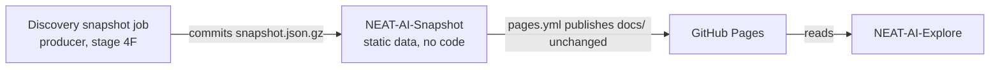

# Compaction migration 4L: audit — no compaction in NEAT-AI-Snapshot

## Summary

Audit of NEAT-AI-Snapshot for whole-creature compaction and duplicated
structural rewrites in snapshot, restore and creature serialisation paths. The
repository holds no executable code, so it has no compaction to replace and no
serialisation path to switch to the shared Rust core API. As the issue directs
when no duplicate exists, this PR records the evidence and changes no code.
Closes #56.

## Spec

### Intent and Rationale

- Stage 4L of the family-wide migration (NEAT-AI-core#775) asks each consumer
  to replace its own compaction with the shared engine. Repositories that do
  not compact are to be audited only and must not acquire new runtime
  compaction.

### Essential Design Decisions

- No compaction call, dependency pin or adapter is added. The repository has
  no runtime, so adding one would be the "new compaction call on a previously
  uncompacted path" the issue forbids.
- The dependency gates (NEAT-AI-core#779 and NEAT-AI#4196, both still open)
  only apply to repositories with a path to switch over. This audit does not
  wait for them, because nothing here would consume either release.

### Undiscoverable Facts

- `docs/snapshot.json.gz` is committed by an external Discovery snapshot job
  (commits titled `Discovery snapshot (auto) <date>`). Any compaction applied
  to the creature happens in that producer, not here. Its migration is tracked
  separately as stage 4F (NEAT-AI-Discovery#2586).

## Evidence

Audited at `bf8eb54`, the head of `Develop`:

- **Tracked files:** `git ls-files` lists 17 files: five workflow YAMLs,
  `.gitattributes`, `.gitignore`, `.markdownlint-cli2.jsonc`, `LICENSE`,
  `README.md`, `docs/index.html`, `docs/Tooltips.json`,
  `docs/snapshot.json.gz`, and four archived PR summaries. Filtering out
  Markdown, YAML, JSON, gzip, HTML and licence files leaves nothing: there is
  no `.ts`, `.js`, `.rs`, `.py` or shell source, and no `deno.json`,
  `package.json` or `Cargo.toml`.
- **`docs/index.html`** is a static page with no script. It only links to
  `snapshot.json.gz`.
- **Workflows:** `pages.yml` uploads `docs/` unchanged with
  `actions/upload-pages-artifact`. The other workflows (`dependency-review`,
  `gitleaks`, `markdown-lint`, `semgrep`) are scanners and linters. None of
  them reads, rewrites or compacts a creature.
- **Search:** `grep -rniE 'compact|prun|simplif'` over `.github/`,
  `docs/*.html`, `README.md` and `docs/archive/` finds nothing.
- **Serialised creature compatibility:** `docs/snapshot.json.gz` decompresses
  and parses as JSON, with top-level sections `meta`, `creature`, `recording`,
  `derived` and `tooltips`. `creature` holds `neurons`, `synapses`, `input` and
  `output`. This PR does not change the file, so downstream readers such as
  NEAT-AI-Explore see exactly the bytes they saw before.

## Test Plan

- No test was added or changed, because the diff touches no code. The
  repository has no test suite and no `quality.sh`. Its CI checks (markdown
  lint, gitleaks, semgrep, dependency review) run on this PR.
- Performance and score semantics are unaffected: the snapshot data and the
  publishing workflow are unchanged.

What was not checked: whether the Discovery producer itself compacts creatures
before writing the snapshot. That code lives in NEAT-AI-Discovery and is stage
4F's audit. Remaining risk: none for this repository.

🤖 Generated with [Claude Code](https://claude.com/claude-code)
