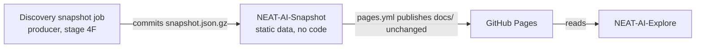

# Compaction migration 4L: audit — no compaction in NEAT-AI-Snapshot

## Summary

This audits NEAT-AI-Snapshot for whole-creature compaction and duplicated
structural rewrites in snapshot, restore and creature serialisation paths. The
repository holds no executable code, so it has no compaction to replace with
the shared Rust core API. As the issue directs when no duplicate exists, this
PR records the evidence and adds no runtime code. It adds the audit record
`docs/audits/compaction-audit.md` and a two-line README pointer to it.
Closes #56.

## Spec

### Intent and Rationale

- Stage 4L of the family-wide migration (NEAT-AI-core#775) asks each consumer
  to replace its own compaction with the shared engine. Repositories that do
  not compact are audited only and must not acquire new runtime compaction.
- The evidence lives in a permanent audit record, not only in this summary, so
  the stage 6 ownership guard (NEAT-AI-core#780) and later readers can find
  this repository's position next to the data.

### Essential Design Decisions

- No compaction call, dependency pin or adapter is added. There is no runtime
  here, so adding one would be the "new compaction call on a previously
  uncompacted path" the issue forbids.
- The dependency gates (NEAT-AI-core#779 and NEAT-AI#4196, both still open)
  apply only to repositories with a path to switch over. This audit does not
  wait for them, because nothing here would consume either release.
- The audit record's creature counts are tied to the audited commit
  (`bf8eb54`), because the Discovery job replaces the snapshot daily.

### Undiscoverable Facts

- `docs/snapshot.json.gz` is committed by an external Discovery snapshot job
  (commits titled `Discovery snapshot (auto) <date>`). Any compaction applied
  to the creature happens in that producer, not here. Its migration is stage
  4F (NEAT-AI-Discovery#2586, open).
- `pages.yml` publishes the whole of `docs/`, so the new audit record is also
  served on GitHub Pages, as the archived PR summaries already are.

## Evidence

The change is documentation only, with no backend, CLI or UI changes. The
audit was done at `bf8eb54`, the head of `Develop`:

- **Tracked files:** `git ls-files` lists workflow YAML, Markdown,
  `docs/index.html`, `docs/Tooltips.json`, `docs/snapshot.json.gz`, `LICENSE`
  and lint/git config. It lists no `.ts`, `.js`, `.rs`, `.py` or shell source,
  and no `deno.json`, `package.json` or `Cargo.toml`.
- **`docs/index.html`** has no script; it only links to `snapshot.json.gz`.
- **Workflows:** `pages.yml` uploads `docs/` unchanged with
  `actions/upload-pages-artifact`. `dependency-review`, `gitleaks`,
  `markdown-lint` and `semgrep` only scan or lint.
- **Search:** `grep -rniE 'compact|prun|simplif'` over `.github/`,
  `docs/*.html`, `docs/Tooltips.json` and `README.md` (before this change)
  finds nothing.
- **Serialised creature compatibility:** a Python check of the decompressed
  snapshot found these sections: `meta`, `creature`, `recording`, `derived`
  and `tooltips`. The `creature` section holds 10,490 neurons (10,486 hidden,
  3 constant, 1 output) and 67,408 synapses, with `input` 2,511 and `output`
  1. There were 0 duplicate neuron UUIDs and 0 dangling synapse endpoints
  outside `input-N` references, and no synapse targets an input. The snapshot
  file and `pages.yml` are unchanged by this PR, so score semantics and
  downstream readers such as NEAT-AI-Explore are unaffected.

## Test Plan

- No test was added or changed, because the diff touches no code. The
  repository has no test suite and no `quality.sh`, so no full gate exists to
  run. Its CI checks (markdown lint, gitleaks, semgrep, dependency review) run
  on this PR.
- `npx markdownlint-cli2@0.23.2 docs/audits/compaction-audit.md README.md
  docs/archive/pr-summaries/pr-summary-56.md` reported 0 issues.

What was not checked: whether the Discovery producer itself compacts creatures
before writing the snapshot. That code lives in NEAT-AI-Discovery and is stage
4F's audit. The issue has no acceptance-criteria list, so no Spec or Standards
reviewer ran. Remaining risk: none for this repository.

🤖 Generated with [Claude Code](https://claude.com/claude-code)
